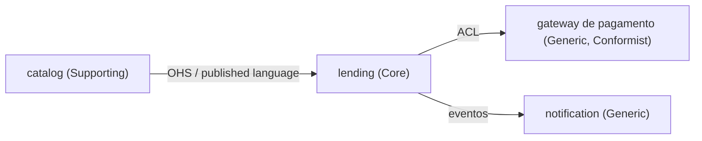
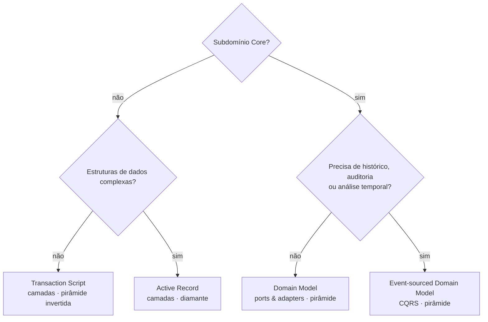

Antes de aplicar este pattern, leia também [`../ddd-hexagonal/SKILL.md`](../ddd-hexagonal/SKILL.md) (a implementação tática e hexagonal das decisões tomadas aqui), [`../requirements-engineering/SKILL.md`](../requirements-engineering/SKILL.md) (glossário, elicitação e Diagrama de Contexto), [`../microservices/SKILL.md`](../microservices/SKILL.md) e [`../modular-monolith/SKILL.md`](../modular-monolith/SKILL.md) (onde os bounded contexts viram serviços ou módulos) e [`../design-docs/SKILL.md`](../design-docs/SKILL.md) (onde as decisões ficam registradas).

# DDD estratégico

O DDD tático (aggregates, value objects, ports) é a parte visível; a parte que decide se o projeto dá certo é a **estratégica**: **o que** o negócio faz, **onde** está o valor, **onde** passam as fronteiras dos modelos e **quanto** esforço de modelagem cada parte merece. Esta skill reúne essas decisões. A implementação delas está em `ddd-hexagonal`, e para a maioria dos serviços simples continua valendo o flat-by-layer de `code-organization`.

## 1. Subdomínios: onde está o valor

O **domínio** é a área de atuação da empresa (uma rede de bibliotecas). Ele se divide em **subdomínios**, cada um uma capacidade de negócio:

| Tipo | Como reconhecer | Exemplo | Estratégia |
|---|---|---|---|
| **Core** | Gera **vantagem competitiva**: é o que a empresa faz diferente dos concorrentes. Lógica **complexa** e **volátil** (o negócio vive mudando para se diferenciar) | `lending` (políticas de empréstimo, reserva, multa por perfil) | Construir dentro de casa, com o time mais experiente e o modelo mais cuidadoso |
| **Supporting** | Específico do negócio, necessário, mas **sem diferencial**; lógica simples, quase sempre CRUD com algumas regras | `membership` (cadastro de sócios), `inventory` (exemplares) | Construir de forma simples, ou terceirizar o desenvolvimento |
| **Generic** | Problema **resolvido** que todo mundo tem; complexo, mas sem diferencial | Identidade, pagamento, notificação, busca textual | **Comprar ou usar pronto** (`aws-cognito`, `aws-ses`, gateway de pagamento — build × buy em `technical-product-management`) |

- **Core não é "o mais importante"**: pagamento é crítico e costuma ser Generic. Core é onde está a **regra que diferencia e muda**.
- **Traçar a fronteira**: um subdomínio é um conjunto **coeso de casos de uso** que trabalham sobre os mesmos dados e atores. Comece pelas capacidades da empresa (departamentos, processos) e divida até que cada parte tenha um tipo claro; pare quando a divisão produzir só casos de uso isolados. Em sistema existente, os grupos saem da análise de `monolith-decomposition`.
- **Especialistas do domínio** são quem conhece a regra (o bibliotecário-chefe, o financeiro), não quem escreve os requisitos sobre eles; o modelo nasce da conversa direta com eles.
- A classificação é uma **decisão de arquitetura**: registre-a no ADR ou no design doc, por subdomínio, com a justificativa.

## 2. Linguagem ubíqua

O código usa **os mesmos termos que os especialistas**, com o mesmo significado, nas conversas, nos documentos, nos testes e nos identificadores (em inglês, regra do pacote).
- **Um termo, um significado** dentro de um contexto. Sinônimos ("livro", "título", "exemplar") viram termos distintos ou um só, decididos com o negócio e registrados no **glossário** (`requirements-engineering`).
- **Sem jargão técnico** na linguagem do negócio ("o registro tem flag 3" não é linguagem do negócio; "o empréstimo está em atraso" é).
- Regras descritas como **cenários** (Given/When/Then — `user-stories`) viram testes com os mesmos nomes.
- Quando o código e o negócio divergem (o negócio diz "renovação", o código diz `extend`), corrija o código: a divergência custa a cada conversa.

## 3. Bounded contexts × subdomínios

**Subdomínios são descobertos; bounded contexts são desenhados.** O bounded context é a fronteira onde **um modelo e uma linguagem** são consistentes:
- "Book" no `catalog` (título, ISBN, autor) e "Book" no `lending` (exemplar físico emprestável, com estado) são **modelos diferentes**, cada um certo no seu contexto. **Não** crie um `Book` universal.
- Um bounded context pode conter um ou vários subdomínios; o comum é alinhar um contexto a um subdomínio Core e agrupar Supporting e Generic relacionados.
- **Tamanho**: grande o bastante para manter a linguagem coerente e as regras que mudam juntas; pequeno o bastante para **um time** ser dono. Um contexto por entity é pequeno demais (toda operação atravessa vários); um contexto com o sistema inteiro é o modelo universal com outro nome.
- **Fronteira física**: um serviço (`microservices`) ou um módulo (`modular-monolith`). **Fronteira de dono**: um time pode ter vários contextos; um contexto não tem dois times.

## 4. Context map

Como os contextos se relacionam, em três famílias:

| Relação | Quando | Risco |
|---|---|---|
| **Partnership** | Dois times que se coordenam de perto e entregam juntos as mudanças de integração | Depende de comunicação constante; não escala entre times distantes |
| **Shared Kernel** | Um modelo pequeno compartilhado (uma biblioteca de tipos) que os dois evoluem juntos | Cresce e vira acoplamento; mantenha mínimo e com dono |
| **Customer–Supplier** | O upstream (fornecedor) atende às necessidades do downstream (cliente) | O downstream depende da prioridade do upstream |
| **Conformist** | O downstream aceita o modelo do upstream como está | Aceitável para Generic; ruim para o Core (o modelo alheio contamina o seu) |
| **Anticorruption Layer (ACL)** | O downstream **traduz** o modelo do upstream para o seu (adapter — `ddd-hexagonal`, `service-communication`) | Custo da tradução; compensa sempre que o upstream é legado, terceiro ou instável |
| **Open-Host Service** | O upstream publica uma API ou um esquema **estável e versionado** (published language) para muitos consumidores (`api-design`, `contract-testing`) | Exige disciplina de compatibilidade |
| **Separate Ways** | Integrar custa mais do que duplicar; cada um resolve do seu jeito | Duplicação consciente; só para o que não é Core |

- **O Core se protege**: downstream de qualquer coisa, usa **ACL**; upstream de muitos, expõe **Open-Host Service**.
- Integração com **Generic comprado** (gateway de pagamento, SaaS) é **Conformist** com o fornecedor e **ACL** na sua borda.
- Desenhe o mapa (Mermaid) e **mantenha-o atualizado** junto à arquitetura (`docs/architecture/`): relações mudam quando os times mudam (seção 7).

## 5. EventStorming

Oficina colaborativa, criada por Alberto Brandolini, para descobrir o domínio com quem o conhece. Serve para projeto novo, modernização de legado e onboarding.
- **Quem**: especialistas do domínio, produto e desenvolvedores; de 6 a 15 pessoas. Sem os especialistas, vira adivinhação.
- **Como**: uma parede longa (ou um quadro online), post-its por cor, de 2 a 4 horas por sessão.

Os passos, em ordem (cada um acrescenta uma camada):
1. **Exploração livre**: todos escrevem **eventos de domínio** no passado ("Empréstimo realizado", "Multa cobrada"), sem ordem nem filtro.
2. **Linha do tempo**: os eventos em ordem cronológica, do caminho feliz para as variações.
3. **Pontos de dor**: onde há dúvida, gargalo ou discordância (post-it de alerta).
4. **Eventos pivô**: os que marcam mudança de fase ("Empréstimo realizado", "Livro devolvido"); separam o fluxo em etapas.
5. **Comandos e atores**: o que dispara cada evento ("Renovar empréstimo") e quem o executa.
6. **Políticas**: as reações automáticas ("sempre que um empréstimo vencer, cobrar multa").
7. **Modelos de leitura**: o que o ator precisa ver para decidir.
8. **Sistemas externos**: o que está fora (gateway de pagamento, e-mail).
9. **Aggregates**: agrupam comandos e eventos sobre o mesmo dado consistente (`ddd-hexagonal`).
10. **Bounded contexts**: onde a linguagem muda e as fronteiras se desenham (seção 3).

O resultado vira artefato: glossário (`requirements-engineering`), eventos candidatos (`messaging`), context map (seção 4) e critérios para o design doc (`design-docs`). Fotografe ou exporte a parede; um EventStorming que não vira documento se perde.

## 6. Árvore de decisão tática

O tipo de subdomínio decide **como implementar a lógica**; a lógica decide **a arquitetura**; a arquitetura decide **a forma da suíte de testes**:

| Lógica de negócio | Quando | Arquitetura | Testes |
|---|---|---|---|
| **Transaction Script** | Supporting ou Generic com dados simples; cada operação é um procedimento sobre os dados | Camadas (o flat-by-layer do pacote) | **Pirâmide invertida**: a lógica está no service junto do banco; muitos testes de integração e poucos unitários |
| **Active Record** | Supporting com estruturas de dados mais complexas; objetos que carregam o dado e regras simples sobre ele | Camadas | **Diamante**: o grosso em testes de integração, com unitários nas regras das entities (o "honeycomb" de `test-patterns`) |
| **Domain Model** | **Core** com regras complexas e invariantes | Ports & adapters (`ddd-hexagonal`) | **Pirâmide**: muitos unitários puros no domínio, menos integração |
| **Domain Model com event sourcing** | **Core** que precisa de histórico, auditoria, análise temporal ou tem dinheiro envolvido | CQRS (`cqrs-event-sourcing`) | **Pirâmide**, com testes de projeção |

- **O flat-by-layer do pacote é um Transaction Script** com entities JPA: o certo para Supporting e Generic, e a modelagem anêmica ali **não é defeito** (`ddd-hexagonal` §6).
- O passo de Transaction Script para algo próximo de **Active Record**, no pacote, é dar à entity os métodos de negócio do seu próprio estado (`solid`, "Estado com regra muda só por método de negócio"), mantendo o layout.
- Qualquer padrão que precise de **vários modelos de leitura** diferentes ganha CQRS, mesmo sem event sourcing.
- A árvore é heurística, não lei: a decisão final vai no ADR com o motivo.

## 7. Evoluir as decisões

O tipo de um subdomínio muda com o negócio, e o desenho deve acompanhar:

| Mudança | Sinal | O que fazer |
|---|---|---|
| **Supporting → Core** | As regras crescem, viram diferencial, e o Transaction Script começa a duplicar regra e encadear `if`s | Migrar para Domain Model (`ddd-hexagonal`, com a refatoração do modelo anêmico em passos) |
| **Generic → Core** | A empresa decide se diferenciar onde antes comprava (busca própria, recomendação) | Trazer para dentro de casa; ACL em volta do produto antigo durante a troca |
| **Core → Generic** | Surge um produto no mercado que faz o mesmo bem | Comprar; o código próprio vira ACL e depois sai |
| **Core → Supporting** | A regra estabilizou e deixou de diferenciar | Simplificar; não precisa manter toda a modelagem |
| **Supporting → Generic** | Aparece solução pronta | Trocar por ela |

**Migrar o padrão de implementação** sem big bang (`refactoring`):
- **Transaction Script → Active Record**: mover a lógica de cada estrutura para a própria entity.
- **Active Record → Domain Model**: identificar invariantes que atravessam objetos e desenhar os aggregates; esconder setters do estado com regra.
- **Domain Model → event sourcing**: o histórico anterior não existe como eventos. Gere **um evento de migração** por aggregate com o estado atual (`LoanMigrated`), honesto sobre o que se sabe, em vez de inventar um passado.

**Mudanças de organização** também mudam o context map: Partnership vira **Customer–Supplier** quando os times se afastam (outra cidade, outra prioridade); Customer–Supplier vira **Separate Ways** quando integrar custa mais do que duplicar. Revise a classificação e o mapa quando mudar o time, a estratégia (`product-strategy`) ou o mercado.

## 8. Anti-patterns

- **DDD tático em tudo**: aggregates e ports num cadastro Supporting.
- **Core tratado como CRUD**: regra espalhada em services, duplicada e sem testes de domínio.
- **Modelo universal** (um `Book` para todos os contextos) ou **contexto por entity**.
- **Shared Kernel que cresce** até virar biblioteca `common` com regra de negócio (`microservices`).
- **Conformist no Core**: o modelo do fornecedor dentro do seu domínio.
- **Context map que ninguém atualiza**, ou que só existe na cabeça de alguém.
- **EventStorming só com desenvolvedores**, ou que não vira artefato.
- **Classificação eterna**: nunca revisar o tipo do subdomínio.

---

## Regras principais

- **Classifique os subdomínios** (Core, Supporting, Generic) por vantagem competitiva, complexidade e volatilidade; Core é o que diferencia, não o mais crítico. Registre no ADR.
- **Linguagem ubíqua**: um termo, um significado por contexto, no glossário e no código; divergência entre código e negócio se corrige no código.
- **Bounded context** é desenhado: um modelo e uma linguagem consistentes, de um time, sem modelo universal nem contexto por entity.
- **Context map com as 7 relações**; o Core se protege com ACL e se expõe com Open-Host Service; Generic comprado é Conformist com ACL na borda; mapa em Mermaid e atualizado.
- **EventStorming** com especialistas, nos 10 passos, e com saída documentada.
- **Árvore de decisão tática**: Transaction Script e Active Record com camadas; Domain Model com ports & adapters; event sourcing com CQRS; a forma da suíte de testes acompanha.
- **Decisões evoluem**: revise o tipo dos subdomínios e o context map; migre o padrão em passos, com evento de migração ao adotar event sourcing.
- **Sem Lombok** — deliberado.

## Referências

- Vlad Khononov, *Learning Domain-Driven Design: Aligning Software Architecture and Business Strategy* (O'Reilly, 2021): subdomínios, linguagem ubíqua, bounded contexts, context map, heurísticas de desenho e árvore de decisão tática, evolução das decisões e EventStorming. Reescrito com o exemplo da biblioteca do pacote.
- EventStorming foi criado por Alberto Brandolini.
